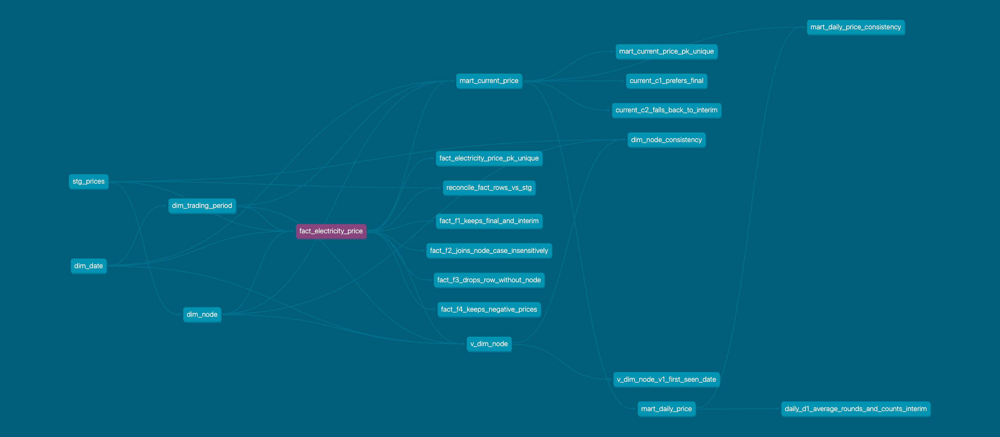

# nz-power-pipeline

NZ electricity market (EMI) wholesale price pipeline: download, store in Azure,
model with dbt, and (planned) load into Snowflake and schedule with Airflow.

Status: work in progress. Ingest, upload and the local dbt models with tests are done.

## Data flow

```
EMI website -> download (Python) -> data/raw/prices/*.csv
            -> upload (Python)   -> Azure ADLS Gen2 (raw container, monthly partitions)
            -> dbt (DuckDB locally) -> staging -> dimensions -> fact -> marts
```

Planned: Snowflake as the warehouse, Airflow for daily runs, GitHub Actions for CI.

## dbt models

| Layer | Model | Grain |
|---|---|---|
| staging | `stg_prices` | one CSV row |
| dimension | `dim_date`, `dim_trading_period`, `dim_node` | day / day x trading period / node |
| fact | `fact_electricity_price` | trading period x node x version (interim / final) |
| mart | `mart_current_price` | trading period x node (final if available, else interim) |
| mart | `mart_daily_price` | trading day x node |
| view | `v_dim_node` | node, with derived `first_seen_date` |

Lineage graph generated by `dbt docs generate` (`uv run dbt docs serve --project-dir dbt --profiles-dir dbt`):



Design notes: `docs/model_design.md`. Source data: `docs/data_dictionary.md`.

## Reference data and credits

Node name, island, zone and distribution region come from the Electricity Authority's EMI
**Network Supply Points table** (snapshot 2026-11-06, `dbt/seeds/node_reference.csv`; source
data © Electricity Authority, https://www.emi.ea.govt.nz). Regenerate with
`uv run python -m nzpower.node_reference` after downloading a new snapshot to `data/raw/reference/`.
Mapping rules are specified by the tests in `tests/test_node_reference.py`; 18 transmission-grid nodes
get island and zone from their site, and node KAW2201 has no zone in the source.

## Run it

Requires [uv](https://docs.astral.sh/uv/). Raw files go in `data/raw/prices/`
(named `YYYYMMDD_final.csv` or `YYYYMMDD_interim.csv`); `data/` is not committed.

```bash
uv sync
uv run dbt build --project-dir dbt --profiles-dir dbt   # build models and run all tests
uv run pytest                                           # ingest and upload tests
uv run ruff check
```

Run dbt from the project root: the raw file path (`raw_prices_glob` in
`dbt/dbt_project.yml`) is relative to it.

## Tests

- dbt generic tests (unique, not_null, relationships, accepted_values) in the YAML files.
- dbt unit tests with hand-made input rows: `dbt/models/marts/_unit_tests.yml`.
- Singular SQL tests in `dbt/tests/`: reconciliation of stg and fact row counts,
  daylight-saving day period counts (46 / 48 / 50), period boundaries in UTC.
